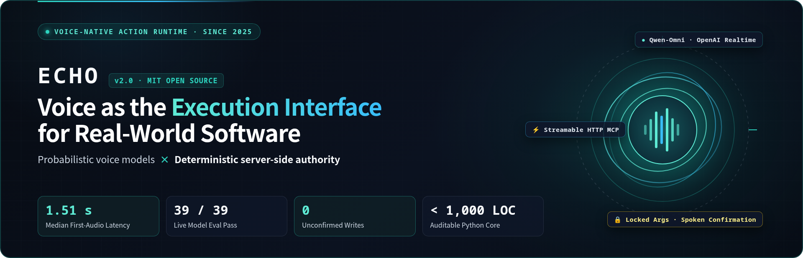
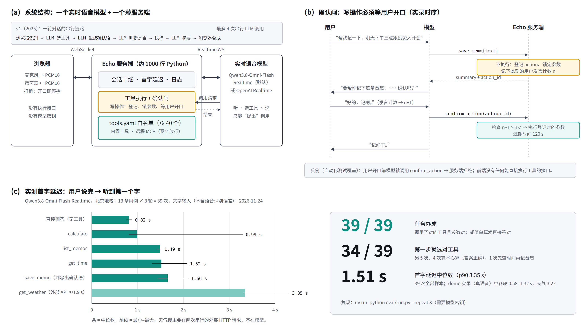

<div align="center">

<p>
  <b>English</b> &nbsp;|&nbsp; <a href="README.zh-CN.md">简体中文</a>
</p>



<br />

<p>
  
  
  
  
</p>

<h3>For 40 years we operated software by clicking through apps. Voice AI learned to chat, yet nobody trusts it with write access.</h3>

<p>
  <a href="docs/media/echo-demo.mp4?raw=true"><b>▶ 72s Demo Video (with audio)</b></a>
  &nbsp;·&nbsp;
  <a href="#paradigm"><b>Paradigm</b></a>
  &nbsp;·&nbsp;
  <a href="#mcp"><b>Connect MCP</b></a>
  &nbsp;·&nbsp;
  <a href="#quickstart"><b>Quick Start</b></a>
  &nbsp;·&nbsp;
  <a href="docs/engineering-notes.md"><b>Engineering Notes</b></a>
</p>

<br />

<a href="docs/media/echo-demo.mp4?raw=true">
  
</a>

<sub>Unedited recording on real Chrome + <code>qwen3.8-omni-flash-realtime</code> (2x silent preview) · <a href="docs/media/echo-demo.mp4?raw=true"><b>Download 72s full video with audio (3.9 MB)</b></a></sub>

</div>

<br />

<table>
<tr>
<td width="33%" valign="top">
<b>⚡ Speak to Execute, Interrupt Anytime</b><br /><br />
Read tools run immediately without extra chatter; speak mid-reply to cut off stale audio in ~<b>1 s</b>. Connect any remote Streamable HTTP MCP server in 5 lines of YAML.
</td>
<td width="33%" valign="top">
<b>🔒 Spoken Authorization Enforced in Code</b><br /><br />
Write actions freeze their parameters server-side and read back a confirmation summary. Execution is blocked until the <b>user's next spoken turn</b>, preventing self-confirmation or arg tampering.
</td>
<td width="34%" valign="top">
<b>🧬 Started in 2025, Distilled to &lt;1,000 LOC</b><br /><br />
Originated in April 2025 (<a href="../../tree/v1.0-2025"><code>v1.0-2025</code></a>) and rebuilt in 2026 into <b>&lt;1,000 lines of auditable Python</b>. Measured live: <b>1.51 s</b> median TTFA, <b>39/39</b> pass, <b>0</b> unconfirmed writes.
</td>
</tr>
</table>

---

<a id="paradigm"></a>
## Paradigm: Probabilistic Voice × Deterministic Authority

| Paradigm | Interaction | Latency & Barge-in | Write-Action Safety | Extending Services |
|---|---|---|---|---|
| **Apps / GUIs** | Open app, tap menus, fill forms | Manual clicks | Modal confirmation buttons | Separate frontend per service |
| **Chained Voice (STT → LLM → TTS)** | Serial multi-hop LLM calls | Multi-second lag, awkward barge-in | Prompt-only guardrails | Glue code or hosted subprocesses |
| **Browser-Direct Realtime Model** | Realtime speech-to-speech | Sub-2s response | Keys & execution tied to model; hallucination = action | Locked to one model API |
| **Echo (Voice-Native Runtime)** | **Speak to act, interrupt naturally** | **1.51 s median TTFA, ~1 s stop** | **Server-locked args + turn gate; no self-confirmation** | **5 lines of `tools.yaml` per remote MCP** |



The browser is a pure PCM16 audio pipe with no API keys and no tool execution endpoint. Every `confirm: true` write action is stored server-side as an immutable `Pending` parameter snapshot and executes only after the user's turn counter advances within 120 s (`echo_agent/confirm.py`). Tools are explicitly whitelisted in `tools.yaml` (hard cap of 40 per session to preserve voice routing accuracy). Whether the user's reply means yes or no is interpreted by the model; see [Engineering Notes](docs/engineering-notes.md#确认闸的边界) for exact boundaries.

---

<a id="mcp"></a>
## Turn Any Remote MCP Service into a Voice Action

Five zero-key built-in tools (`get_time`, `calculate`, `get_weather` via Open-Meteo, `list_memos`, `save_memo`) let you test the full read, write, and confirmation loop out of the box. Connect real services via Streamable HTTP MCP in `tools.yaml`:

```yaml
mcp_servers:
  - name: amap                                  # Read-only: Amap official remote MCP
    url: https://mcp.amap.com/mcp?key=${AMAP_KEY}
    prefix: amap_
    allow: [maps_weather, maps_text_search]
  - name: calendar                              # Example write-gated MCP (not built-in)
    url: https://mcp.example.com/mcp
    headers: {Authorization: "Bearer ${CALENDAR_TOKEN}"}
    allow: [list_events, create_event]
    confirm: [create_event]                     # Enforced by server confirmation gate
    summaries: {create_event: "Create event {title} at {start}. Confirm?"}
```

Every tool must be explicitly listed in `allow`. Missing env vars, unknown tools, or unreachable servers fail closed for that server only without breaking others. Echo never hosts third-party local subprocesses and opens a clean stateless HTTP call per execution (`echo_agent/mcp_remote.py`).

---

<a id="quickstart"></a>
## Quick Start

```bash
uv sync
cp .env.example .env          # Set ECHO_PROVIDER_URL and ECHO_PROVIDER_API_KEY
set -a; . ./.env; set +a
uv run echo-server            # Open http://127.0.0.1:8000
```

For public deployment, set `ECHO_ACCESS_TOKEN` and serve over HTTPS (required by browsers for microphone access). Verify locally: `uv run pytest` (no API key needed), `uv run python eval/run.py` (live model benchmark), `./demo/record.sh` (one-command headless demo recording).

---

## Live Benchmarks & Production Voice Lessons

Tested on `2026-11-24` against `qwen3.8-omni-flash-realtime` (13 cases × 3 runs, text input): **39/39** task completion, **34/39** first-step exact tool choice, **1.51 s** median first-audio latency (`0.82 s` direct reply, `0.99–1.66 s` local tools, `3.35 s` p90). Three real-world voice lessons baked into Echo:

1. **Semantic VAD swallows short confirmations.** Default `semantic_vad` filters short replies like "yes" / "好的" as backchannels, stalling voice confirmations. Switching Qwen 3.8 series to `semantic_vad_ec` fixes it.
2. **In-flight stale audio leaks after barge-in.** Flushing the browser buffer isn't enough because old frames are still on the wire. Echo drops server-side audio after `speech_started` until the next `response_created`.
3. **Ground relative dates in tool outputs.** Returning a 7-day forecast with explicit weekdays eliminates weekend-date hallucinations.

Full per-case eval metrics, real-voice confirmation logs, and recording reproducibility details are in [`docs/engineering-notes.md`](docs/engineering-notes.md).

---

## Next

- **Transaction-grade authorization**: Layer server-side intent verification, amount caps, and recipient allowlists on top of the turn gate for payments and on-chain transfers.
- **Dynamic tool routing**: Scale beyond the 40-tool static whitelist with low-latency semantic retrieval.
- **More endpoints**: The thin WebSocket + PCM16 protocol extends directly to in-car systems, wearables, and hardware voice terminals.

<details>
<summary><b>Evolution (2025 v1 → 2026 v2): Why Rewriting Shrank the Core to &lt;1,000 Lines</b></summary>

Echo began in April 2025 (full prototype and commit history preserved at tag [`v1.0-2025`](../../tree/v1.0-2025)). In v1, achieving one-sentence tool execution required up to 4 serial LLM hops per turn and 3,000+ lines of MCP subprocess management. In late 2026, native realtime speech-to-speech models and Streamable HTTP MCP allowed collapsing the entire paradigm into ~1,000 lines of Python.

| 2025 v1 | 2026 v2 |
|---|---|
| Browser STT → LLM tool pick → LLM confirm prompt → LLM yes/no → Execute → LLM summary → Browser TTS (up to 4 serial LLM calls) | Single native realtime speech-to-speech model |
| Confirmed every request; client could call `/execute` directly | Instant reads; server-locked write confirmation with zero client execution endpoint |
| Hosted and monitored local MCP subprocesses (3,000+ LOC) | Stateless remote Streamable HTTP MCP via official SDK |
| Dumped all tools into prompt | Explicit `tools.yaml` whitelist (cap 40) |
| MySQL + Alembic + JWT + developer portal | Access token + local JSONL session logs |

</details>

<details>
<summary><b>Repository Layout</b></summary>

```
echo_agent/      server.py entry & auth · session.py relay & barge-in · realtime.py dialect adapter
                 confirm.py confirmation gate · tools.py whitelist · mcp_remote.py remote MCP · builtin.py
web/index.html   Single-file browser client (mic, playback, barge-in, server execution log panel)
tools.yaml       Tool whitelist & confirmation rules
eval/            Live model accuracy & latency eval     demo/  One-command headless demo recorder
docs/            engineering-notes.md & media/ (hero banners, social card, video, GIF, Figure 1)
tests/           Offline protocol, confirmation gate, barge-in & MCP tests
```

</details>
